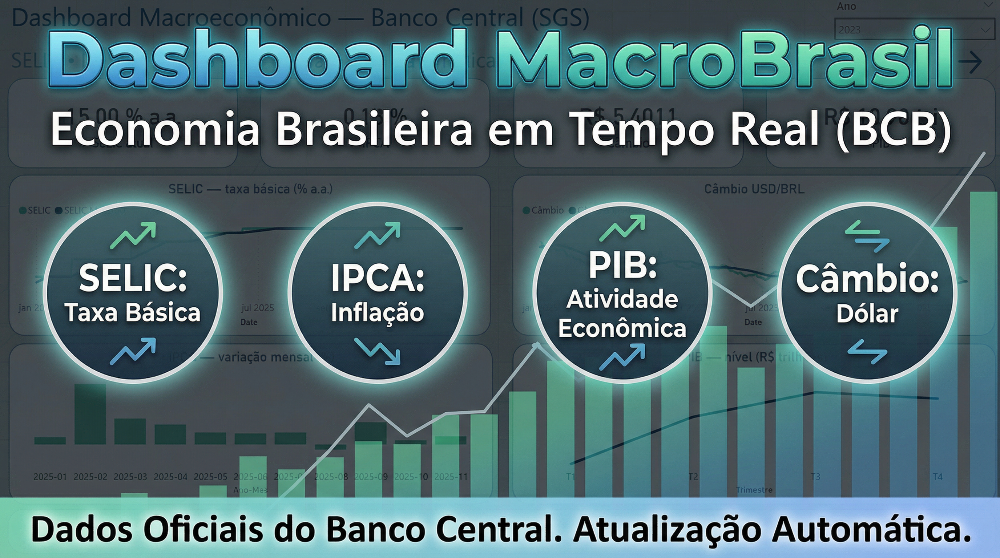

# Dashboard Macroeconômico — Banco Central (SGS)



Este projeto apresenta um dashboard macroeconômico desenvolvido em Power BI a partir de dados públicos do Banco Central do Brasil (SGS).

O objetivo é fornecer uma leitura clara e executiva do cenário macroeconômico brasileiro, analisando política monetária, inflação, câmbio e atividade econômica.

## 🔗 Acesso ao Dashboard (Power BI Online)

O dashboard está publicado no Power BI Service e pode ser acessado pelo link abaixo:

👉 [**Visualizar Dashboard**](https://app.powerbi.com/view?r=eyJrIjoiNWJkNzQyMzUtOTcxMC00NDI2LWJiNTUtMDRkMTMzNjVjZGRmIiwidCI6IjhjYzJkZWQ2LWEzYjktNDk4My04ZDcxLTY3OGZjN2E2NjRiZSJ9)


> O acesso é público e não requer autenticação.

## Indicadores analisados
- SELIC — taxa básica de juros
- IPCA — inflação ao consumidor
- Câmbio (USD/BRL)
- PIB — atividade econômica (dados trimestrais)

## Fonte de dados
- Banco Central do Brasil — Sistema Gerenciador de Séries Temporais (SGS)  
- https://dadosabertos.bcb.gov.br/

## Tecnologias
- Power BI
- Power Query
- DAX
- API do Banco Central (SGS)

## Observações
Projeto com finalidade educacional e demonstrativa, utilizando exclusivamente dados públicos.

## 🌐 Incorporação em Site (Embed)

O dashboard também pode ser incorporado diretamente em sites ou portfólios pessoais utilizando o iframe abaixo:

```html
<iframe 
  title="Dashboard Macroeconômico — Banco Central do Brasil (SGS)" 
  width="600" 
  height="373.5" 
  src="https://app.powerbi.com/view?r=eyJrIjoiNWJkNzQyMzUtOTcxMC00NDI2LWJiNTUtMDRkMTMzNjVjZGRmIiwidCI6IjhjYzJkZWQ2LWEzYjktNDk4My04ZDcxLTY3OGZjN2E2NjRiZSJ9" 
  frameborder="0" 
  allowFullScreen="true">
</iframe>

