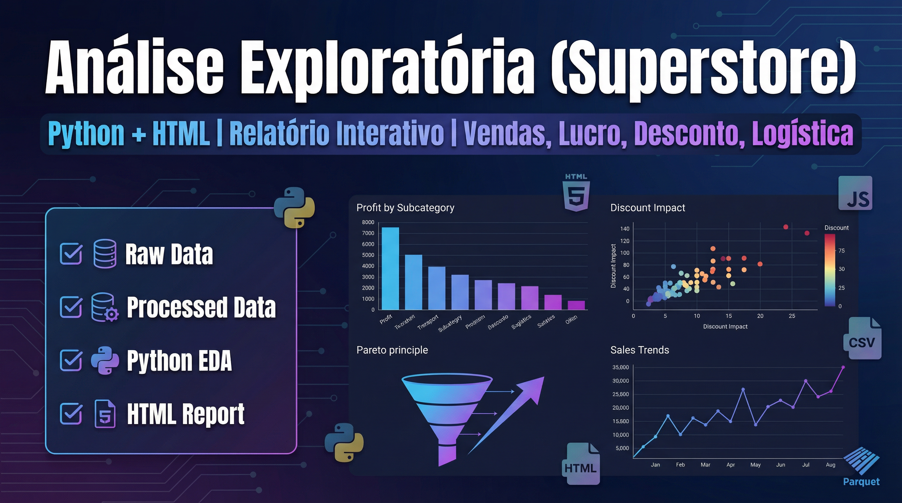

# 📊 Superstore — EDA Interativa (Python + HTML)



👉 [**Visualizar Dashboard**](https://guicorrea93.github.io/portfolio-projetos/02-superstore-eda-interativa/report/)

Este projeto apresenta uma **análise exploratória de dados (EDA)** completa sobre o dataset **Sample Superstore**, combinando **Python para processamento e análise** com um **relatório interativo em HTML** para visualização executiva dos resultados.

O foco não é apenas gerar gráficos, mas **contar a história dos dados**, explorando vendas, lucro, clientes, descontos, logística e concentração de receita de forma clara e acionável.

---

## 🎯 Objetivos do projeto

- Explorar a performance comercial da Superstore sob múltiplas dimensões  
- Identificar padrões de **concentração de receita**, **margem** e **desconto**  
- Separar claramente **camada analítica (Python)** da **camada de apresentação (HTML)**  
- Produzir um relatório final com **visual executivo**, pronto para tomada de decisão  

---

## 🧱 Estrutura do projeto
## 🧱 Estrutura do projeto

```text
02-superstore-eda-interativa/
├─ data/
│  ├─ raw/
│  │  └─ Sample - Superstore.xlsx
│  └─ processed/
│     ├─ superstore_processado.csv
│     └─ superstore_processado.parquet
├─ notebooks/
│  └─ 01_eda_superstore.ipynb
└─ report/
   ├─ assets/
   │  ├─ app.js
   │  ├─ charts.js
   │  └─ style.css
   └─ index.html
```


**Descrição das camadas:**

- **data/raw**: dados originais, sem tratamento  
- **data/processed**: base limpa e padronizada, usada nas análises  
- **notebooks**: EDA completa em Python (pandas, matplotlib, seaborn, plotly)  
- **report**: arquivos de suporte ao relatório HTML  
- **index.html**: relatório final interativo  

---

## 🔬 O que foi analisado

A análise cobre, entre outros pontos:

- Distribuição de vendas (com controle de outliers via P99)  
- Correlação entre vendas, lucro, quantidade e desconto  
- Evolução temporal das vendas  
- Sazonalidade mensal  
- Ticket médio por categoria  
- Lucro por subcategoria  
- Performance por segmento  
- Impacto do desconto no lucro  
- Logística: tempo de entrega e ship mode  
- Geografia: ranking por região/estado  
- Clientes:
  - Top clientes por vendas
  - Curva de concentração de receita (Pareto / 80–20)

---

## 💡 Principais insights

Alguns achados relevantes do projeto:

- Uma pequena parcela dos clientes concentra a maior parte da receita (efeito Pareto)
- Descontos elevados tendem a destruir margem, mesmo quando aumentam o volume
- Categorias e subcategorias apresentam comportamentos muito distintos de lucro
- Modos de envio impactam diretamente eficiência logística e performance financeira

Esses insights estão consolidados visualmente no relatório HTML.

---

## 🛠️ Tecnologias utilizadas

- **Python**: pandas, numpy, matplotlib, seaborn, plotly  
- **Visualização**: Plotly (exportado como JSON)  
- **Front-end**: HTML, CSS e JavaScript puro  
- **Formato de dados**: CSV e Parquet  

---

## ▶️ Como visualizar o relatório

1. Clone este repositório  
2. Abra o arquivo `index.html` no navegador  
3. O relatório é totalmente estático (não depende de backend)

---

## 📌 Observação final

Este projeto foi desenvolvido com foco em **portfólio profissional**, priorizando clareza analítica, boas práticas de organização e comunicação de resultados.

---

**Autor:** Guilherme  
