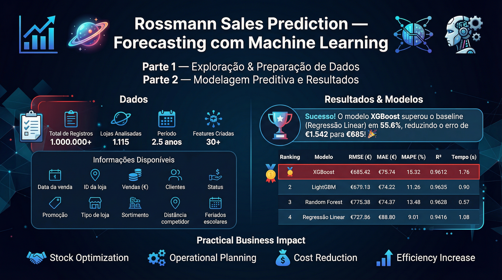

# 🪐📊 Rossmann Sales Prediction — Forecasting com Machine Learning



👉 [**Visualizar Dashboard**](https://guicorrea93.github.io/portfolio-projetos/04-rossmann-previsao-vendas/)

📊 Parte 1 — Exploração & Preparação de Dados  
🤖 Parte 2 — Modelagem Preditiva e Resultados  

Este projeto apresenta uma **análise completa de previsão de vendas (forecasting)** para a rede de drogarias **Rossmann**, utilizando **Python, Machine Learning e séries temporais**, culminando em um **relatório interativo em HTML**, voltado para decisão executiva.

O objetivo vai além de treinar modelos:  
👉 **entender o comportamento das vendas**,  
👉 **engenheirar variáveis de negócio**,  
👉 **comparar algoritmos**,  
👉 **avaliar impacto prático no negócio**.

---

## 🎯 Objetivo do Projeto

Desenvolver um modelo de **Machine Learning robusto** capaz de prever as **vendas diárias por loja**, permitindo:

- 📦 Otimização de estoque  
- 👥 Planejamento de recursos operacionais  
- 💰 Redução de custos  
- 📈 Aumento de eficiência comercial  

O projeto simula um **cenário real de forecasting**, respeitando rigorosamente a natureza temporal dos dados (sem data leakage).

---

## 🧱 Estrutura do Projeto

```text
04-rossmann-previsao-vendas/
├─ data/
│  ├─ raw/
│  │  ├─ train.csv
│  │  └─ store.csv
│  └─ processed/
│     ├─ train_processed.csv
│     ├─ test_processed.csv
│     └─ features.json
├─ notebooks/
│  ├─ 01_rossmann_exploration.ipynb
│  └─ 02_rossmann_modeling.ipynb
└─ report/
   ├─ assets/
   │  ├─ css/
   │  ├─ js/
   └─ index.html

## ▶️ Como Executar

```powershell
py -3.13 -m venv .venv
.venv\Scripts\pip install -r requirements.txt
```

Depois rode os notebooks em ordem: `01_rossmann_exploration.ipynb` gera
`data/processed/` e `02_rossmann_modeling.ipynb` treina e salva os modelos em
`models/`. Essas duas pastas e o `.venv` ficam fora do git.

